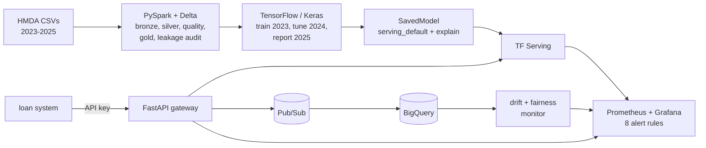

# Lending decision platform

[](https://github.com/Tajaddin/lending-decision-platform/actions/workflows/ci.yml)

**Mortgage decisioning on 37 million real HMDA applications: a PySpark + Delta Lake pipeline, a TensorFlow model
that refers risky applications with adverse-action reasons, served by TF Serving, with every decision streamed
through Pub/Sub into BigQuery for drift and fair-lending monitoring. Terraform for GCP, a Databricks Asset Bundle
for the batch side.**

## The problem

A lender wants to send applications that are likely to be denied to an underwriter early, with the reasons, and
needs to know the model is honest about three things regulators ask about: does it use information that only
exists after the decision (leakage), does it hold up on next year's applications (drift), and does it treat
protected groups worse than the lenders already do (disparate impact).

## Results (all from committed files in [`reports/`](reports))

| What | Result | Source |
|---|---|---|
| Pipeline | **37.3M raw records (2023-2025) to a 15.1M-application model population in 384 s** (bronze, silver, quality, gold, leakage audit, export), 0 critical data-quality failures, bronze and silver row counts reconcile exactly | [`pipeline-run.json`](reports/pipeline-run.json), [`data-quality.json`](reports/data-quality.json) |
| Leakage gate | The first full run **stopped itself** on `initially_payable_to_institution` (filled in for 99.7% of approvals, 87.4% of denials); CLTV and the AUS result were excluded the same way | [`leakage-audit.json`](reports/leakage-audit.json), [ADR 0002](docs/adr/0002-leakage-audit-gates-the-feature-list.md) |
| Model, 2025 hold-out (5.44M applications, never seen in training or tuning) | **AUC 0.870 (95% CI 0.869-0.870), KS 0.586, ECE 0.010**; referring 32.7% of applications catches 80.0% of the lenders' denials | [`model-metrics.json`](reports/model-metrics.json) |
| Baselines on the same split | XGBoost AUC 0.871, logistic regression 0.806: the network matches gradient boosting and beats the linear model by 0.064 | same |
| Reasons vs lenders | On 20,000 real 2025 denials, the lender's stated reason (debt-to-income or collateral) is the model's top reason **71.1%** of the time and among its top four **93.0%** | same |
| Fair lending | Audit **fails** the model for age 62+ (AIR 0.761 vs the lenders' 0.930) and for Black applicants (0.759 vs 0.827): it would widen existing gaps, so the model card marks it **not approved** | [`fairness.json`](reports/fairness.json), [model card](docs/MODEL-CARD.md) |
| Less discriminatory alternative | 9 training runs (reweighing, two equalized-odds penalties), chosen on 2024, scored once on 2025: the best **closes all five of v1's gaps** (age 62+ 0.955, Black 0.872) for 0.025 AUC and 40.5% referrals instead of 32.7%, but **newly flags Asian applicants** (1.002 vs the lenders' 1.036), so nothing is approved yet | [`lda-search.json`](reports/lda-search.json), [ADR 0010](docs/adr/0010-protected-attributes-may-shape-the-training-loss.md) |
| Stability | Score PSI vs 2023: 0.004 on 2024, 0.016 on 2025; largest input shift `applicant_credit_score_type` (PSI 0.174). Replaying 5,000 real 2025 applications through the live stack, the monitor measured 0.185 for the same input | [`psi.json`](reports/psi.json), [`replay-monitor.json`](reports/replay-monitor.json) |
| Spark | Silver stage on the 13.5M-row 2025 year: **553 s on 1 core, 93 s on 16 (5.95x)**; batch scoring of all 5.44M 2025 applications with the SavedModel in **19.3 s** on 8 cores | [`spark-bench.json`](reports/spark-bench.json), [`batch-scoring.json`](reports/batch-scoring.json) |
| Online serving (k6, 2 API workers + TF Serving on one machine) | **0 failures, p99 36 ms at 400 req/s**; p99 229 ms at 600 req/s with 0.34% shed; at 800 req/s 30.8% is shed with fast 503s and the service recovers at once (the first version broke permanently under that load; see the [Sprint 3 retro](docs/sprints/sprint-3.md)) | [`reports/k6/`](reports/k6) |
| On Databricks (Free Edition, serverless) | The same bundle job ran the whole pipeline on the 14 GB of CSV in **441 s**, first attempt; every row count, quality result, leakage flag and split is **identical to the local run** | [`reports/databricks/`](reports/databricks) |
| On GCP (Cloud Run with the TF Serving sidecar, Pub/Sub, BigQuery) | Serves model v1; decisions in 112-169 ms from a home connection in Tampa; 401 without a key; every decision **in BigQuery within 5 s** through the Pub/Sub subscription | [`reports/cloud/smoke.json`](reports/cloud/smoke.json) |

Hardware for every local timing: one desktop, Intel i5-13600KF (14 cores / 20 threads), WSL2 Ubuntu 24.04 with
15.5 GB, data on the WSL ext4 disk. The Databricks and GCP rows ran on 2026-10-18 ([docs/DEPLOY.md](docs/DEPLOY.md)).

## Architecture



Details, data flow and the nine architecture decision records: [docs/ARCHITECTURE.md](docs/ARCHITECTURE.md).

## Run it

```bash
make up            # TF Serving, API, Pub/Sub + BigQuery emulators, sink, monitor, Prometheus, Grafana
```

Then send a real 2025 application and look at the dashboard:

```bash
curl -s localhost:8200/v1/decisions -H 'X-API-Key: local-dev-key-branch-app-0001' \
  -H 'content-type: application/json' -d @bench/k6/one-application.json
make replay        # 5,000 held-out applications at 50/s, then open http://localhost:3005
```

The committed model (`models/ldp/1`, 805 KB) is enough for the stack. To rebuild everything from the raw data
(about 2 GB download, 14 GB unzipped, Java 17+):

```bash
make install download pipeline train   # or: docker compose --profile jobs run --rm jobs pipeline ...
```

Tests: `make check` (unit, Spark and TensorFlow tests with coverage, shellcheck, bats) and
`pytest -m integration` (real TF Serving, Pub/Sub and BigQuery emulators through Testcontainers).

## What is in it

- **Data contract** in one module (`src/ldp/schema.py`): HMDA decoders with Spark twins tested for identical
  output, the model inputs, and the fields that may never be inputs (protected, geographic, post-decision).
- **Spark pipeline** with declarative quality checks (critical stops the run), a statistical leakage gate, an
  out-of-time split and Delta versions recorded in the model metadata. The same code writes Unity Catalog tables
  on Databricks (`LDP_LAKE_ROOT=uc:catalog.schema`).
- **TensorFlow model** with preprocessing inside the SavedModel and an `explain` signature that returns
  integrated-gradient attributions (tested for completeness), calibrated with Platt scaling on 2024.
- **Gateway** without TensorFlow: API keys, per-client rate limit, validated HMDA codes, 422s that never echo
  applicant data, 503 when the model is down, one Pub/Sub event per decision.
- **Monitoring**: PSI per input and for the score, adverse impact ratio by group, alert rules with promtool tests,
  a provisioned Grafana dashboard.
- **Infrastructure as code**: Terraform for Cloud Run (TF Serving sidecar, model from Cloud Storage), Pub/Sub
  with a BigQuery subscription and dead-lettering, Secret Manager, Workload Identity Federation, budget alert;
  validated, linted (tflint) and scanned (trivy) in CI, and applied to a GCP project (49 resources). Databricks
  Asset Bundle deployed and run on Free Edition serverless compute. The first real runs found four bugs the local
  stack could not: see the [cloud retro](docs/sprints/cloud-deploy.md).
- **Process**: sprints as GitHub milestones with user stories and story points, one PR per sprint, retros in
  [docs/sprints](docs/sprints).

## Limitations

- **Cloud timings are a single run each.** Cloud Run latencies are from one home connection, so mostly network,
  and Cloud Run was not load tested. Keyless deploys from GitHub Actions are provisioned but not switched on (the
  repository variables are not set). Steps: [docs/DEPLOY.md](docs/DEPLOY.md).
- **The label is the lender's decision, not repayment**, and HMDA has no credit score or history. The model
  predicts what lenders did; it inherits their practices and cannot cite credit reasons.
- **The fairness audit fails, and so does the best alternative found.** The model is a demonstration of the full
  lifecycle, including a gate that rejects it. The less-discriminatory-alternative search fixes v1's five flagged
  groups on 2025 but trips the audit's "no more than 0.02 below the lenders" rule for Asian applicants at parity
  with White applicants; whether that rule should apply at parity is a policy question, left open. See the model
  card for the drivers, the trade-off table and the reasons.
- XGBoost is 0.0014 AUC ahead; the TensorFlow model is served because preprocessing and explanations ship in one
  SavedModel behind TF Serving (ADR 0004, 0005).
