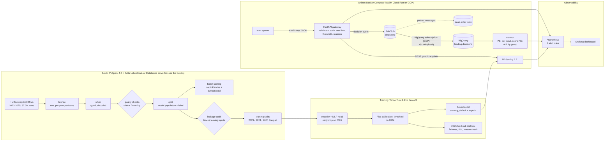

# Architecture

## The decisions behind it

| ADR | Decision |
|---|---|
| [0001](adr/0001-spark-and-delta-for-the-batch-layer.md) | PySpark and Delta for the batch layer; one session factory for laptop, CI and Databricks |
| [0002](adr/0002-leakage-audit-gates-the-feature-list.md) | A leakage audit gates the feature list and stops the pipeline |
| [0003](adr/0003-out-of-time-split-by-year.md) | Train 2023, choose on 2024, report on 2025 |
| [0004](adr/0004-preprocessing-inside-the-savedmodel.md) | Preprocessing lives in the SavedModel; serving receives raw typed inputs |
| [0005](adr/0005-integrated-gradients-for-adverse-action-reasons.md) | Integrated gradients for adverse-action reasons, served by TF Serving |
| [0006](adr/0006-protected-attributes-are-for-monitoring-only.md) | Protected attributes and tract demographics are for monitoring only |
| [0007](adr/0007-tf-serving-behind-a-thin-gateway.md) | TF Serving behind a thin gateway without TensorFlow |
| [0008](adr/0008-decision-events-through-pubsub-into-bigquery.md) | Decision events through Pub/Sub into BigQuery |
| [0009](adr/0009-gcp-cloud-run-with-a-sidecar-and-databricks-for-batch.md) | Cloud Run with a TF Serving sidecar on GCP; Databricks for the batch jobs |

## Where the code is

| Path | What |
|---|---|
| `src/ldp/schema.py` | The data contract: decoders, model inputs, excluded fields |
| `src/ldp/spark/` | bronze, silver, quality, gold, batch scoring; `lake.py` hides Delta path vs Unity Catalog table |
| `src/ldp/audit.py` | Leakage audit |
| `src/ldp/training/` | Model, export with signatures, baselines, evaluation, fairness, model card |
| `src/ldp/serving/` | FastAPI gateway, TF Serving client, events, API keys, rate limit |
| `src/ldp/streaming/` | BigQuery schema and the Pub/Sub sink |
| `src/ldp/monitoring/` | Drift and fairness monitor, replay tool |
| `infra/terraform/` | GCP: Cloud Run, Pub/Sub, BigQuery, Cloud Storage, Secret Manager, WIF, budget |
| `databricks/` | Asset Bundle: the pipeline as a serverless job |
| `observability/` | Prometheus config, alert rules with promtool tests, Grafana dashboard |
